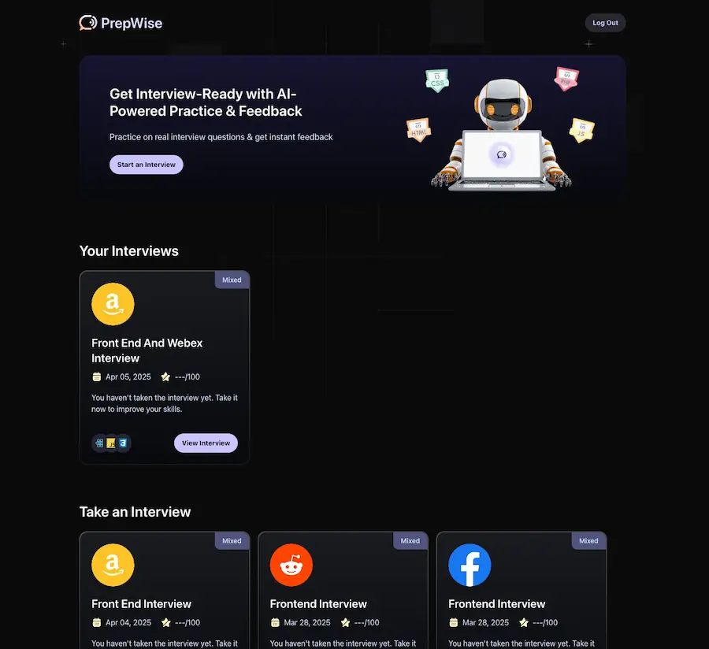

<div align="center">
  <br />
  <br />
  
  # <code>PREPWISE</code>
  
  **AI-POWERED INTERVIEW PRACTICE PLATFORM**
  
  <br />

  
  
  
  
  

  <br />
  <br />
</div>

---

### 00 __ PREVIEW



> **ABSTRACT:** Plataforma de práctica de entrevistas de trabajo con IA conversacional en tiempo real. Sistema de voz integrado (Vapi) + análisis de feedback con Google Gemini. Firebase backend para autenticación y persistencia de datos.
>
> <br />
>
> **ORIGIN:** Based on [JavaScript Mastery Tutorial](https://www.youtube.com/watch?v=your-video-id).
> *Adapted with Firebase integration, custom feedback system, and interview history.*
>
> <br />
>
> **DEMO:** [prepwise-ai.vercel.app](https://ai-interview-nextjs-six.vercel.app/)

---

### 01 __ ARCHITECTURE & DECISIONS

| COMPONENT | TECH | NOTE |
| :--- | :--- | :--- |
| **Core** | `Next.js 15 (App Router)` | Server Actions + TypeScript strict mode. |
| **UI Framework** | `Shadcn/ui + Tailwind CSS` | Radix primitives + utility-first styling. |
| **Voice AI** | `Vapi.ai SDK` | Real-time voice conversation engine. |
| **Feedback AI** | `Google Gemini` | Post-interview analysis generation. |
| **Auth & DB** | `Firebase (Admin + Client)` | Firestore para datos + Firebase Auth. |
| **State** | `React Context API` | Minimal client-side state management. |

<br>

### 02 __ INSTALLATION

*Run local environment:*

```bash
# 1. Clone
git clone https://github.com/samuhlo-training/ai-interview-nextjs.git

# 2. Install dependencies
npm install

# 3. Configure environment variables
# Create .env.local with:
# - Firebase credentials
# - Vapi API keys
# - Gemini API key

# 4. Ignite
npm run dev
```

### 03 __ KEY FEATURES / SNIPPETS

#### A. VOICE INTERVIEW FLOW
Sistema de entrevista por voz con Vapi SDK:

```typescript
// Agent.tsx - Real-time voice interaction
const handleCallEnd = async () => {
  const transcript = assistantTranscript || ""
  const feedback = await generateFeedback(transcript)
  await saveInterviewResults(feedback)
}
```

#### B. AI FEEDBACK GENERATION
Análisis automático post-entrevista:

```typescript
// Gemini integration for performance analysis
const generateFeedback = async (transcript: string) => {
  const model = genAI.getGenerativeModel({ model: "gemini-pro" })
  const prompt = `Analyze this interview: ${transcript}`
  return await model.generateContent(prompt)
}
```

#### C. FIREBASE SERVER ACTIONS
Autenticación y persistencia sin API routes:

```typescript
// auth.action.ts - Server-side authentication
export async function signInUser(email: string, password: string) {
  "use server"
  const auth = getAuth()
  return await signInWithEmailAndPassword(auth, email, password)
}
```

<div align="center">

<br />

<code>DESIGNED & CODED BY <a href='https://github.com/samuhlo'>samuhlo</a></code>

<br />

<small>Lugo, Galicia</small>

</div>
